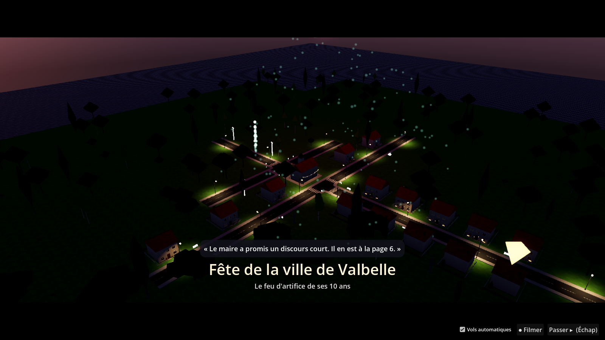
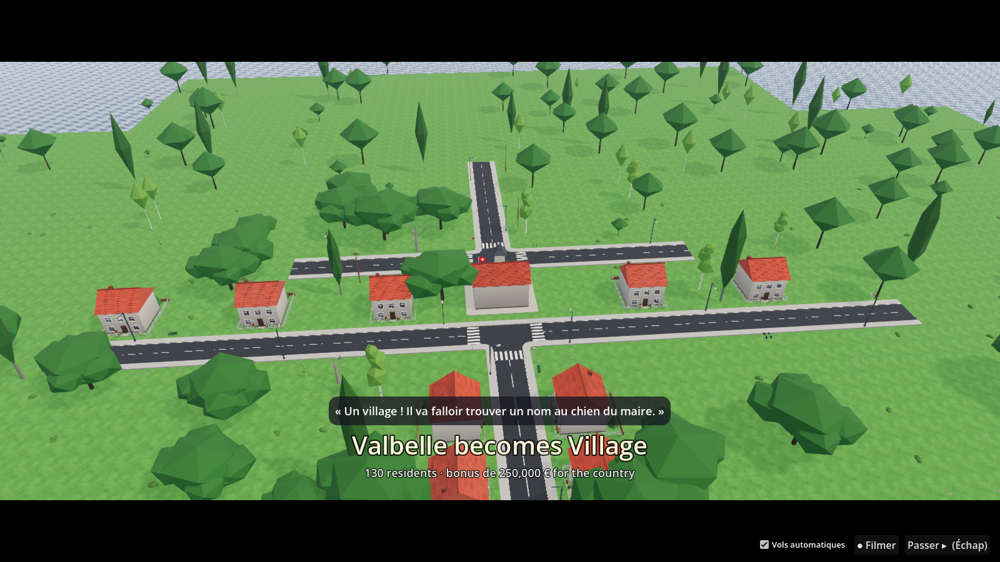

# Vols cinématiques et grands événements

Deux nouveautés « pour le spectacle » : la caméra survole la ville comme un
drone de télévision quand il se passe quelque chose d'important, et trois
grands événements sont faits pour être filmés.

## Vol cinématique

- **Quand** : à chaque nouveau palier d'une ville (Hameau → Village → Bourg →
  Ville → Ville moyenne → Grande ville → Métropole), à la fête de la ville au
  moment du feu d'artifice, à l'inauguration d'un grand monument et au départ
  du premier train. Plusieurs à la fois : ils passent l'un après l'autre (3 au
  plus en attente).
- **Ce qu'on voit** : l'interface disparaît, des bandes noires de cinéma
  descendent, la caméra fait un grand cercle en hauteur puis descend en
  spirale vers le lieu (14 s, 16 s quand elle suit un train). Un titre
  (« Valbelle devient Village »), un sous-titre (habitants, prime) et la bulle
  d'un habitant qui réagit (« Un village ! Il va falloir trouver un nom au
  chien du maire. »). Au palier, un petit feu d'artifice part de la mairie.
- **Passer** : un clic n'importe où, **Échap**, **Espace** ou le bouton
  **Passer ▸**. Le jeu revient exactement où il était (caméra, interface,
  vitesse du temps).
- **Le temps** : pendant le vol, la vitesse passe au plus à « 10 min/s » pour
  que la fête ne se termine pas avant la fin du survol, puis reprend. En pause,
  le temps reste en pause.
- **● Filmer** (en bas à droite pendant le vol) : enregistre le vol en vidéo
  AVI (Motion JPEG, lisible par VLC, le lecteur Windows, DaVinci Resolve) dans
  `Images/MiniBlocs/Vidéos`. Chaque image du jeu devient une image de la vidéo
  à 24 images/s : le film reste fluide même si l'ordinateur rame.
- **Vols automatiques** (case à cocher pendant le vol) : décochée, plus aucun
  vol ne part tout seul. Réglage du joueur (`user://cinematique.cfg`), valable
  pour toutes les parties.
- **Filmer à la main** : Infos (**I**) → En cours → bouton **Filmer** sur
  n'importe quel événement en cours (marché, fête, match, incendie…).

## Grands événements (Infos, I)

| Événement | Quand | Ce qui se passe |
| --- | --- | --- |
| **Fête de la ville** | Chaque année, le jour anniversaire de la fondation (Maison de commune), dès 30 habitants, de 20 h à minuit (réglage Admin « Fêtes, marchés et matchs organisés tout seuls »). Ou organisée par le joueur : Infos → Organiser → **Fête de la ville** (25 000 €), pour la ville sous la caméra, ce soir. | Tables, guirlandes, scène et foule devant la mairie. **Feu d'artifice à 22 h** (pivoines, saules, anneaux, bouquet final) et vol cinématique. |
| **Inauguration** | Quand le chantier d'un grand monument (Patrimoine, Fin) se termine. | Ruban tricolore, foule, applaudissements, feu d'artifice tout de suite et vol autour du monument. |
| **Premier train** | La première ligne de train de voyageurs d'une ville (sa première gare). Une seule fois par ville. | Foule sur le quai, sifflet, applaudissements ; la caméra **suit la rame** pendant le vol. |

Le fil d'actualité et le journal racontent la suite (« Les derniers sont
rentrés à pied, en chantant faux. »).

## Sons

Deux sons ajoutés à `tools/sons/effets.py` (synthèse maison, CC0) :
`feu_artifice` (sifflement qui monte, boum, crépitement) et
`applaudissements` (foule qui applaudit et crie « bravo »). Ils s'entendent en
3D, depuis le lieu.

## Pour les développeurs

- `scripts/photo/vol_cinematique.gd` (`VolCinematique`) : `lancer({centre,
  rayon, titre, sous_titre, bulle, son, duree, suivre: Callable -> Vector3,
  auto})`, `passer()`, signaux `en_vol(on)` et `fini(passe)`.
  `position_vol(vise, rayon, u)` donne la trajectoire.
- `scripts/evenements/feux_artifice.gd` (`FeuxArtifice`) : nœud à poser au pas
  de tir (`duree`, `cadence`, `rayon`, `arreter()`), suit EchelleTemps.
- `scripts/evenements/grands_evenements.gd` (`GrandsEvenements`) : module des
  types `fete_ville`, `inauguration`, `premier_train` d'Evenements (nouveau :
  `Evenements.planificateurs`, objets avec `plan_day(n)` et `step(t, dt)`).
  Sauvegardé dans la section `evenements` → `grands` (villes déjà fêtées).
- Signaux ajoutés : `Objectifs.palier_gagne(vid, palier)` et
  `Patrimoine.inaugure(bid)`. Branchement : `terre_main._setup_cinematique()`.
- Test : `tests/grands_evenements_test.gd`. Captures :
  `tests/grands_evenements_vitrine.gd -- --sortie dossier` (avec affichage).
